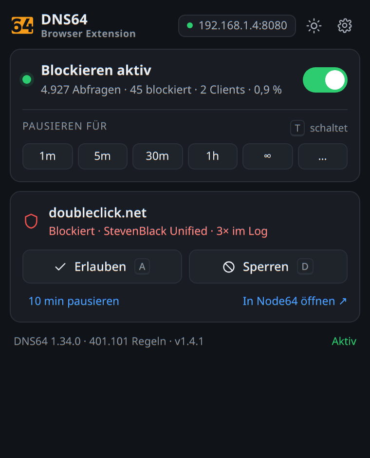

# DNS64 Browser Extension

Browser-Erweiterung (Chromium/Brave, Manifest V3) als Gegenstück zur Pi-hole-Erweiterung:
Blocklisten des DNS64-Moduls von **Node64** ein-/ausschalten, aktuelle Domain freigeben
oder sperren – ohne die Weboberfläche zu öffnen.



**Ausführliche Dokumentation:** [`docs/DOKUMENTATION.md`](docs/DOKUMENTATION.md) – Architektur,
API-Abbildung, Sicherheitsmodell, Audit-Ergebnisse, Testprotokoll, Bauen und Ausliefern.

## Was sie kann

| Element | Funktion | API |
|---|---|---|
| Schalter oben | Blockieren an/aus (aus = bis zum Wiedereinschalten) | `POST /dns64/resume`, `POST /dns64/pause {minutes:0}` |
| `1m` … `∞`, `…` | Blockieren für 1/5/30/60 min, unbegrenzt oder eigene Dauer (1–1440 min) pausieren | `POST /dns64/pause {minutes}` |
| Kennzahlen | Abfragen, blockiert, Clients, Quote der letzten 24 h | `GET /dns64/summary?range=24h` |
| Domain-Karte | Status der aktiven Seite samt Blockliste | `GET /dns64/log?q=…`, `/dns64/allowlist`, `/dns64/denylist` |
| **Erlauben** (A) | Domain in die Freigabeliste (gilt auch für Subdomains); hebt eine eigene Sperre auf | `POST/DELETE /dns64/allowlist` |
| **Sperren** (D) | Domain in die eigene Sperrliste der Node (samt Subdomains); hebt eine Freigabe auf | `POST/DELETE /dns64/denylist` |
| `10 min pausieren` | Kurze Pause für alle Listen | `POST /dns64/pause` |
| `In Node64 öffnen` | Weboberfläche der Node | – |
| Hell/Dunkel | folgt automatisch System bzw. Brave; der Knopf im Kopf kehrt es um (relativ, bleibt weiter am System) | `prefers-color-scheme` + `chrome.storage` |
| Abzeichen am Symbol | Zustand: `ON` grün = Listen greifen, `OFF` orange = pausiert, `!` rot = Node/Key-Problem (kein Zähler) | `GET /dns64/status` |

Tastenkürzel: <kbd>T</kbd> Blockieren umschalten, <kbd>A</kbd> erlauben, <kbd>D</kbd> sperren.

## Status der Seite – woher er kommt

DNS64 hat keinen Endpunkt „ist Domain X gesperrt?“. Die Erweiterung liest deshalb – wie die
Pi-hole-Erweiterung – das Abfrage-Log und prüft zuerst die ausdrücklichen Regeln:

1. **eigene Sperrliste** der Node (`/dns64/denylist`, gilt inkl. Subdomains) → „Von dir gesperrt“
2. **Freigabeliste** (`/dns64/allowlist`, gilt inkl. Subdomains) → „Freigegeben“
3. **Log** der Domain (exakt, sonst Elterndomain) → `blocked` / `allowed` / `custom` / `error`
4. sonst „Noch keine Abfrage im Log“ – die Domain lässt sich trotzdem freigeben oder sperren.

Weil das Log 7 Tage (bzw. `retention_days` der Node) zurückreicht, ist für fast jede besuchte
Seite ein Eintrag vorhanden. `custom` (lokaler Eintrag, z. B. `nas.home.lan`) wird als solcher
angezeigt und nicht als Sperre. Blockiert die eigene Sperrliste, steht im Log
`status: blocked` mit `reason: own:<domain>` – das wird als eigene Sperre angezeigt, nicht als
Listen-Treffer.

**Erlauben und Sperren nutzen ausschließlich die vorhandenen Endpunkte der Node** – dieselben,
die auch das Webinterface benutzt. Beide Listen schließen sich serverseitig aus: wer eine
Domain freigibt, fliegt aus der Sperrliste und umgekehrt. Referenz der Node: `/api/docs`
(HTML) und `/api/openapi.json` (maschinenlesbar).

## Installation (Brave/Chromium)

### A) Entpackt laden (schnell, 3 Klicks)

1. `brave://extensions` öffnen, **Entwicklermodus** oben rechts einschalten.
2. **Entpackte Erweiterung laden** → Ordner `/home/badguy/git/dns64-switch` wählen.
3. Symbol anpinnen, anklicken, Node-Adresse + API-Key eintragen.

### B) Aus dem eigenen Store (ohne Entwicklermodus)

`dns64-switch.crx` liegt im Projektordner daneben (`~/git/dns64-switch.crx`,
ID `afeiagkmnfjohhngcmpkolbgjgelilai`). Auf dem Unraid-Store (Port 8115) abgelegt,
erscheint sie auf der Store-Seite und lässt sich per Klick installieren; für die
stille Installation schreibt `brave-ext-store-linux.sh` die
`External Extensions/<id>.json`.

**Wichtig:** `.pem` (`~/git/dns64-switch.pem`) aufbewahren – sie bestimmt die ID. Geht sie
verloren, gilt die Erweiterung als neu (andere ID, leerer Speicher, API-Key neu eintragen).

Nach dem Wechsel von A) auf B) die entpackte Fassung in `brave://extensions` entfernen,
sonst laufen zwei Instanzen mit verschiedenen IDs.

## API-Key

In Node64 unter **Einstellungen › API-Keys** einen Key anlegen (Name z. B. `Browser-Extension`).
Der Key wird nur einmal angezeigt und liegt danach nur in `chrome.storage.local` dieser
Erweiterung. Die Erweiterung spricht ausschließlich diese Node an (`host_permissions` sind
weit gefasst, damit beliebige Node-Adressen funktionieren; die Anfragen gehen nur an die
eingetragene Adresse).

Rechte der Erweiterung: `storage`, `activeTab`, `alarms`.

## Dateien

```
manifest.json      MV3, Popup + Optionsseite + Service Worker
popup.html/.css/.js   Bedienoberfläche (380 px), Karten, Tastenkürzel
options.html/.js      Node-Adresse + API-Key, Verbindungstest
theme.js/.css         Hell/Dunkel (relativer Umschalter) und Farbpalette
background.js         Zustandsanzeige am Symbol (ON/OFF/!, 1-min-Alarm)
icons/                16/32/48/128 px – Logo von Node64 (Apache-2.0, siehe NOTICE.md)
docs/                 Dokumentation und Bilder (nicht im Paket)
NOTICE.md, LICENSE.md Herkunft des Logos, Apache-2.0-Text
```

## Bauen

```bash
~/git/dns64-switch-build.sh        # -> ~/git/dns64-switch.crx (ohne docs/, ohne Schlüssel)
```

Signiert wird mit `~/git/dns64-switch.pem` (bestimmt die ID `afeiagkmnfjohhngcmpkolbgjgelilai`).

## Symbol

Das Icon ist das Logo von [Node64](https://github.com/ipv64net/node64) (Kachel „64",
`static/img/node64.svg`), gerendert aus dem Vektor in 16/32/48/128/512 px. Lizenz
Apache-2.0 (Text in `LICENSE.md`), Herkunft und Abgrenzung in `NOTICE.md`.
Die Erweiterung ist nicht Teil von Node64.

Die Ziffern der Kachel sind **transparent**, nicht weiß hinterlegt: dadurch nehmen sie
automatisch die Farbe dessen an, worauf das Symbol liegt – dunkle Ziffern auf dunkler
Leiste, helle im hellen Modus. Das ersetzt eine Theme-Abfrage und stimmt immer, auch
wenn Brave-Theme und Systemeinstellung auseinanderlaufen.

## Lizenz

Apache License 2.0 – vollständiger Text in [`LICENSE.md`](LICENSE.md), Copyright 2026 GrepVortex.
Das Node64-Logo in `icons/` stammt aus dem Node64-Projekt (Apache-2.0) und bleibt Eigentum der
Prox IT UG / ipv64.net; Herkunft und Abgrenzung in [`NOTICE.md`](NOTICE.md).
Die Erweiterung ist nicht Teil von Node64.

## Grenzen

- Pausen und Freigaben gelten **nodeweit**, nicht pro Gerät: DNS64 kennt Domänen-Freigaben
  global, Gerätegruppen (`/dns64/groups`) haben eigene Regeln, die diese Erweiterung nicht anfasst.
- Die Untergrenze für Pausen ist 1 Minute (API-Limit), deshalb gibt es kein `10s`/`30s`.
- Der Status stammt aus dem Log – eine Domain, die noch nie aufgelöst wurde, gilt als unbekannt.
- Nur der DNS64-Teil der Node-API wird genutzt; Healthchecks, DynDNS usw. nicht.

## Testen ohne die echte Installation

`popup.html?site=example.com` öffnet das Popup mit einer festen Domain statt der des
aktiven Tabs – praktisch, um den Domänenstatus zu prüfen.
